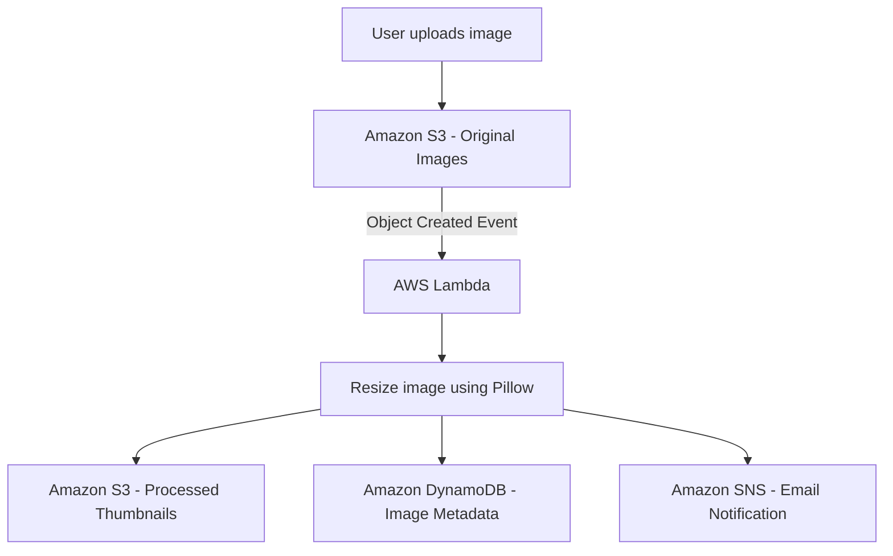
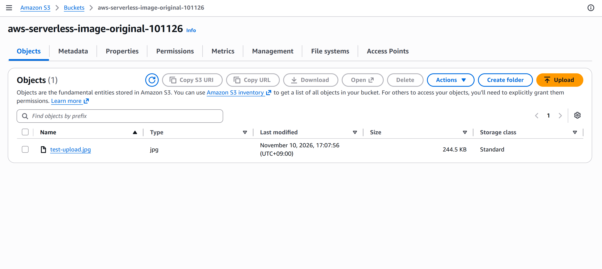
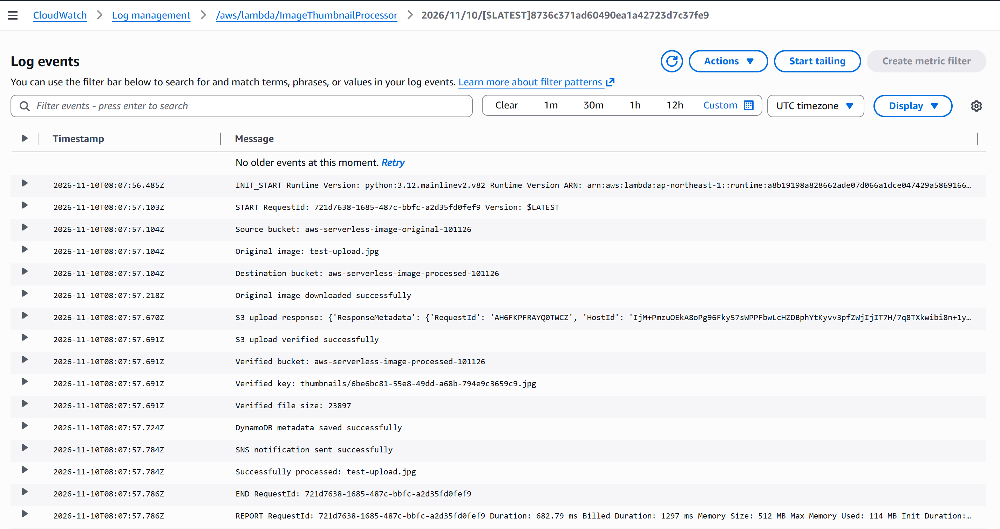
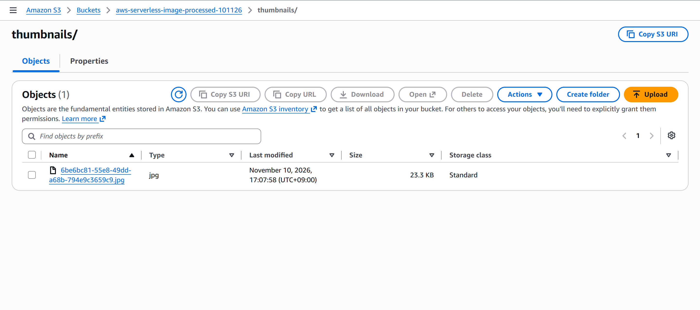
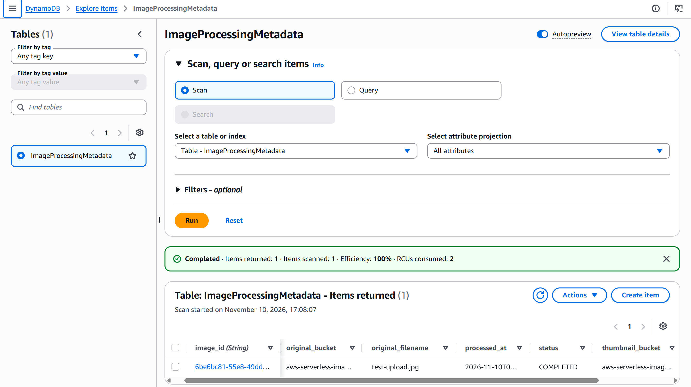
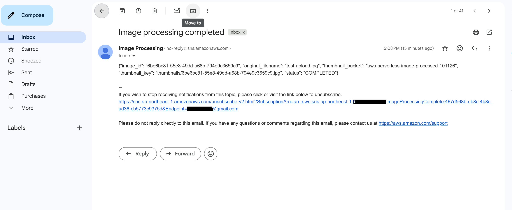

# AWS Serverless Image Processing Pipeline

An event-driven, serverless image processing solution built using Amazon S3, AWS Lambda, Amazon DynamoDB, Amazon SNS, and AWS IAM.

## Project Overview

This project automatically processes images uploaded to an Amazon S3 bucket.

When a user uploads a JPG or PNG image, an S3 event notification triggers an AWS Lambda function. The function resizes the image using Python and Pillow, stores the processed thumbnail in a second S3 bucket, records image metadata in DynamoDB, and sends an email notification through Amazon SNS.

## Architecture

## AWS Services Used

| Service | Purpose |
|---|---|
| Amazon S3 | Stores original and processed images |
| AWS Lambda | Executes image processing automatically |
| Amazon DynamoDB | Stores image processing metadata |
| Amazon SNS | Sends completion email notifications |
| AWS IAM | Controls permissions between services |
| Amazon CloudWatch | Stores Lambda execution logs |

## Processing Workflow

1. A user uploads a JPG or PNG image to the original S3 bucket.
2. An S3 Object Created event triggers the Lambda function.
3. Lambda downloads the original image.
4. Python Pillow resizes the image to fit within 300 × 300 pixels.
5. The processed image is converted to JPEG.
6. Lambda uploads the thumbnail to the processed S3 bucket.
7. Image metadata is saved in DynamoDB.
8. SNS publishes an email notification confirming successful processing.

## Lambda Function

**Function name:** `ImageThumbnailProcessor`

**Runtime:** Python 3.12

**Dependency:** Pillow

The Lambda function performs the following operations:

- Downloads the original image from S3.
- Resizes the image.
- Converts the output to JPEG.
- Uploads the thumbnail to the destination bucket.
- Saves metadata in DynamoDB.
- Publishes a completion notification through SNS.

### IAM Role and Permissions

The Lambda function uses the IAM role `ImageProcessingLambdaRole`.

**AWS-managed policy:**
- `AWSLambdaBasicExecutionRole` — allows Lambda to create and write CloudWatch Logs.

**Custom inline policy:**
- `s3:GetObject` — read original images and verify processed thumbnails.
- `s3:PutObject` — upload resized thumbnails to the processed S3 bucket.
- `dynamodb:PutItem` — store image processing metadata.
- `sns:Publish` — send image processing completion notifications.

The custom IAM policy is available in [`iam-policy.json`](iam-policy.json).

Permissions follow the principle of least privilege by restricting access to the specific project resources.

## DynamoDB Metadata

Table name: `ImageProcessingMetadata`

Partition key: `image_id` (String)

Stored attributes include:

- `image_id`
- `original_bucket`
- `original_filename`
- `thumbnail_bucket`
- `thumbnail_key`
- `status`
- `processed_at`

## IAM Permissions

The Lambda execution role uses:

- `AWSLambdaBasicExecutionRole` for CloudWatch logging.
- `s3:GetObject` for reading original images.
- `s3:PutObject` for saving thumbnails.
- `dynamodb:PutItem` for storing metadata.
- `sns:Publish` for sending completion notifications.

Permissions are restricted to the project resources.

## Testing and Validation

The complete pipeline was tested by uploading multiple image files.

| Test | Result |
|---|---|
| Original image uploaded to S3 | Passed |
| S3 event triggered Lambda | Passed |
| Image resized successfully | Passed |
| Thumbnail saved to processed S3 bucket | Passed |
| Metadata stored in DynamoDB | Passed |
| SNS email notification received | Passed |

## Security Considerations

- S3 buckets are configured for private storage.
- Lambda accesses AWS services through an IAM execution role.
- SNS publishing is restricted to the project topic.
- No AWS access keys or credentials are stored in the source code.

## Cleanup

After project testing and documentation:

1. Remove the S3 event notification.
2. Delete the Lambda function.
3. Delete the Lambda deployment package and any associated Lambda Layer, if created.
4. Delete the DynamoDB table.
5. Delete the SNS email subscription and topic.
6. Delete the original and processed S3 buckets and their contents.
7. Delete the IAM role and project-specific policies.
8. Review CloudWatch log groups and remove them if no longer required.

## Skills Demonstrated

- Serverless AWS architecture
- Event-driven application design
- AWS Lambda deployment
- Python image processing
- Amazon S3 event notifications
- DynamoDB data storage
- SNS email notifications
- IAM roles and policies
- CloudWatch troubleshooting

---

**Project:** AWS Serverless Image Processing Pipeline  
**Region:** Asia Pacific (Tokyo) — `ap-northeast-1`

---

## Project Screenshots

### 1. Original S3 Bucket

### 2. Lambda Execution — CloudWatch

### 3. Processed S3 Bucket

### 4. DynamoDB Metadata

### 5. SNS Email Notification

